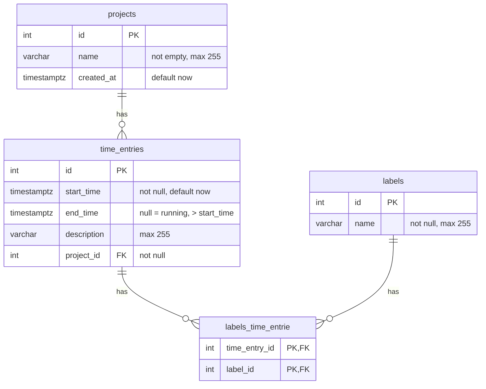

# Typescript Clock App

Time tracking app: clock in and out on a project, add labels, edit the
timeline and see statistics per project and per label.

- **Backend:** Bun + Elysia + Valibot, in `backend/`.
- **Frontend:** React + Vite + TanStack Router + Tailwind, in `frontend/`.
- **Database:** Postgres 18 in Docker (`docker-compose.yml`, `init.sql`).

## Contents

1. [Getting started](#getting-started)
2. [API](#api)
3. [Types](#types)
4. [Database](#database)
5. [Scripts](#scripts)

## Getting started

### Requirements

- [Bun](https://bun.sh) (backend and frontend; do not use npm or pnpm).
- Docker with Docker Compose.
- Optional: Nix. `nix develop` opens a shell with Bun and Docker, and starts
  the database (`flake.nix`).

### 1. Clone the repository

```bash
git clone git@github.com:WanderVafla/TS-clock-app-WanderVafla.git
cd TS-clock-app-WanderVafla
```

### 2. Create the `.env` file

```bash
cp .env.example .env
```

Then set the values:

| Variable          | Example     | Used by                                          |
| ----------------- | ----------- | ------------------------------------------------ |
| `DB_NAME`         | `clock`     | Postgres and the backend                         |
| `DB_USER`         | `postgres`  | Postgres admin; creates the tables               |
| `DB_PASSWORD`     | `secret`    | Postgres admin password                          |
| `DB_PORT`         | `5432`      | Port of Postgres on your machine                 |
| `APP_DB_USER`     | `app_user`  | User of the backend, with read/write rights only |
| `APP_DB_PASSWORD` | `change_me` | Password of `APP_DB_USER`                        |

`.env` is in `.gitignore`. Never commit it.

### 3. Start the database

```bash
docker compose up -d
```

On the first start, Postgres runs `init.sql` (tables, indexes, rules,
default projects and labels) and `init_db.sh` (creates `APP_DB_USER`).
These files run only when the volume is empty. To recreate the database
from scratch, delete the volume:

```bash
docker compose down -v && docker compose up -d
```

### 4. Start the backend

```bash
cd backend
bun install
bun run dev
```

The API listens on `http://localhost:8000` and reloads on file changes.
It reads `../.env`.

### 5. Start the frontend

In another terminal:

```bash
cd frontend
bun install
bun run dev
```

Open `http://localhost:3000`. Vite forwards every `/api/...` request to the
backend (`/api/projects` → `http://localhost:8000/projects`).

## API

Base URL: `http://localhost:8000` (from the frontend: `/api`).

### Response format

Every response has the same envelope.

Success:

```json
{ "success": true, "status": 200, "data": {}, "metadata": {} }
```

`metadata` is only sent by `GET /entries`.

Error:

```json
{
  "success": false,
  "name": "VALIDATION",
  "status": 422,
  "message": "Date is not correct"
}
```

| Status | When                                                                        |
| ------ | --------------------------------------------------------------------------- |
| `404`  | The item does not exist, or a `project_id` / `label_id` points to nothing   |
| `409`  | Conflict: a timer already runs, entries overlap, or the link already exists |
| `422`  | Invalid body or query (type, range, missing field)                          |
| `500`  | Unexpected server error                                                     |

All bodies are JSON (`Content-Type: application/json`). Ids are integers
from 1. Names and descriptions are trimmed and at most 255 characters.

### Projects: `/projects`

| Method   | Body / query                      | Success                    | Errors                            |
| -------- | --------------------------------- | -------------------------- | --------------------------------- |
| `GET`    | -                                 | `200`, array of projects   | -                                 |
| `POST`   | `{ "name": "Work" }`              | `201`, the new project     | `422`                             |
| `PATCH`  | `{ "id": 2, "name": "Client A" }` | `200`, the updated project | `404`, `422` (no field to update) |
| `DELETE` | `?id=2`                           | `200`, `{ "id": 2 }`       | `404`                             |

Deleting a project also deletes all its time entries (`on delete cascade`).

```bash
curl http://localhost:8000/projects
```

```json
{
  "success": true,
  "status": 200,
  "data": [
    { "id": 1, "name": "General", "created_at": "2026-11-23T09:58:24.910Z" },
    { "id": 2, "name": "Work", "created_at": "2026-11-23T09:58:24.910Z" }
  ]
}
```

### Labels: `/labels`

| Method   | Body / query                    | Success                  | Errors       |
| -------- | ------------------------------- | ------------------------ | ------------ |
| `GET`    | -                               | `200`, array of labels   | -            |
| `POST`   | `{ "name": "Bug" }`             | `201`, the new label     | `422`        |
| `PATCH`  | `{ "id": 1, "name": "Bugfix" }` | `200`, the updated label | `404`, `422` |
| `DELETE` | `?id=1`                         | `200`, `{ "id": 1 }`     | `404`        |

Deleting a label only removes its links to entries; the entries stay.

```bash
curl http://localhost:8000/labels
```

```json
{
  "success": true,
  "status": 200,
  "data": [
    { "id": 1, "name": "Bug" },
    { "id": 2, "name": "Feature" },
    { "id": 3, "name": "Meeting" }
  ]
}
```

### Entries: `/entries`

#### `GET /entries`

Returns time entries. Without `sizePage` it returns all matching entries;
with `sizePage` it returns one page.

| Parameter    | Type          | Default      | Description                                                              |
| ------------ | ------------- | ------------ | ------------------------------------------------------------------------ |
| `id`         | integer       | -            | Return only the entry with this id                                       |
| `project_id` | integer       | -            | Return only entries of this project                                      |
| `page`       | integer       | `1`          | Page number, starts at 1. Requires `sizePage`                            |
| `sizePage`   | integer       | -            | Entries per page, from 1 to 100. Enables pagination                      |
| `order`      | string        | `start_time` | Sort column: `id`, `start_time`, `end_time`, `description`, `project_id` |
| `from`       | ISO timestamp | -            | Start of the time range (included)                                       |
| `to`         | ISO timestamp | -            | End of the time range (excluded)                                         |

- With `from` / `to`, the response keeps every entry that overlaps
  `[from, to)`: it starts before `to` and ends after `from`. A running entry
  (no `end_time`) counts as still going. Either bound can be left out.
- Sorting is descending: the newest entry comes first. Entries with the same
  value in the sort column are ordered by `id`, so pages stay stable.
- `422`: `to` not after `from`, a value that is not an ISO timestamp, `page`
  without `sizePage`, `sizePage` above 100, a value below 1 or an unknown
  `order` column.
- A `page` after the last page returns an empty `data` array with `200`.

```bash
curl "http://localhost:8000/entries?page=1&sizePage=2"
```

```json
{
  "success": true,
  "status": 200,
  "data": [
    {
      "id": 158,
      "start_time": "2026-11-23T13:10:36.550Z",
      "end_time": null,
      "description": null,
      "project_id": 1
    },
    {
      "id": 157,
      "start_time": "2026-11-23T08:00:00.000Z",
      "end_time": "2026-11-23T10:27:08.492Z",
      "description": "R running",
      "project_id": 1
    }
  ],
  "metadata": {
    "page": 1,
    "sizePage": 2,
    "total": 158,
    "totalPages": 79,
    "sorted": "start_time"
  }
}
```

| `metadata` field | Description                                                               |
| ---------------- | ------------------------------------------------------------------------- |
| `page`           | Current page (`1` without `sizePage`)                                     |
| `sizePage`       | Entries per page. Absent without `sizePage`                               |
| `total`          | Number of entries that match the filters, across all pages                |
| `totalPages`     | `ceil(total / sizePage)`; without `sizePage`: `1`, or `0` if `total` is 0 |
| `sorted`         | Column used for sorting                                                   |

#### `POST /entries`

Creates a finished or running entry, with optional labels.

```bash
curl -X POST http://localhost:8000/entries -H 'Content-Type: application/json' \
  -d '{"project_id": 2, "start_time": "2026-11-20T08:00:00Z", "end_time": "2026-11-20T09:30:00Z", "description": "Code review", "label": [2, 3]}'
```

```json
{
  "success": true,
  "status": 201,
  "data": {
    "id": 159,
    "start_time": "2026-11-20T08:00:00.000Z",
    "end_time": "2026-11-20T09:30:00.000Z",
    "description": "Code review",
    "project_id": 2
  }
}
```

| Field         | Required | Description                                                     |
| ------------- | -------- | --------------------------------------------------------------- |
| `project_id`  | yes      | Project of the entry                                            |
| `start_time`  | yes      | ISO timestamp                                                   |
| `end_time`    | yes      | ISO timestamp after `start_time`, or `null` for a running entry |
| `description` | no       | Text; `""` is saved as `null`                                   |
| `label`       | no       | Array of label ids                                              |

- `422`: `end_time` not after `start_time`, or a running entry that starts in the future.
- `409`: the entry overlaps another one, or a timer is already running.
- `404`: unknown project or label.

#### `PATCH /entries`

Body: `id` and at least one of `project_id`, `start_time`, `end_time`,
`description`, `label`. `label` **replaces** all labels of the entry; `[]`
removes them. Returns `200` with the updated entry. Same errors as `POST`,
plus `404` when the entry does not exist.

```bash
curl -X PATCH http://localhost:8000/entries -H 'Content-Type: application/json' \
  -d '{"id": 159, "description": "Code review (team)", "label": [3]}'
```

#### `DELETE /entries?id=159`

Returns `200` with `{ "id": 159 }`, or `404`. The links to labels are
deleted with the entry; the labels stay.

### Entry labels: `/entries/label`

Links between time entries and labels (many-to-many).

| Method   | Body / query                                            | Success                 | Errors                                          |
| -------- | ------------------------------------------------------- | ----------------------- | ----------------------------------------------- |
| `GET`    | `?time_entry_id=1&time_entry_id=2` and/or `?label_id=3` | `200`, array of links   | `422`                                           |
| `POST`   | `{ "time_entry_id": 1, "label_id": 3 }`                 | `201`, the new link     | `404` unknown entry or label, `409` link exists |
| `DELETE` | `?time_entry_id=1&label_id=3`                           | `200`, the deleted link | `404`                                           |

- `GET` filters are lists: repeat the parameter for several ids, at most 100
  ids per parameter. Without a filter it returns all links.

```bash
curl "http://localhost:8000/entries/label?time_entry_id=1&time_entry_id=2"
```

```json
{
  "success": true,
  "status": 200,
  "data": [
    { "time_entry_id": 1, "label_id": 2 },
    { "time_entry_id": 2, "label_id": 3 },
    { "time_entry_id": 2, "label_id": 1 }
  ]
}
```

### Clock: `/clock`

The clock keeps one timeline: at most one timer runs at a time, and entries
never overlap. A running timer is an entry with `end_time: null`.

| Method | Path            | Body                                                        | Success                                     | Errors                                                                  |
| ------ | --------------- | ----------------------------------------------------------- | ------------------------------------------- | ----------------------------------------------------------------------- |
| `GET`  | `/clock`        | none                                                        | `200`, `true` if a timer runs, else `false` | -                                                                       |
| `POST` | `/clock/in`     | `project_id`, `description?`, `label?`                      | `201`, the running entry                    | `409` a timer is already running, `404` unknown project or label, `422` |
| `POST` | `/clock/out`    | none                                                        | `200`, the finished entry                   | `404` no timer is running                                               |
| `POST` | `/clock/change` | `project_id?`, `description?`, `label?`, at least one field | `200`, the new running entry                | `404` no timer is running, `404` unknown project or label, `422`        |

`/clock/change` never edits the running entry. It closes it and starts a new
one at the same moment, so time already tracked keeps its project and labels:

- a field that is not sent is copied from the closed entry;
- `label` is an array of label ids and replaces the labels; `[]` clears them;
  without `label` the labels of the closed entry are copied.

```bash
curl -X POST http://localhost:8000/clock/in -H 'Content-Type: application/json' \
  -d '{"project_id": 2, "label": [2]}'
curl -X POST http://localhost:8000/clock/change -H 'Content-Type: application/json' \
  -d '{"label": [3]}'
curl -X POST http://localhost:8000/clock/out
```

Response of `/clock/in`:

```json
{
  "success": true,
  "status": 201,
  "data": {
    "id": 160,
    "start_time": "2026-11-23T14:02:11.120Z",
    "end_time": null,
    "description": null,
    "project_id": 2
  }
}
```

Response of `GET /clock`:

```json
{ "success": true, "status": 200, "data": true }
```

### Statistics: `/statistics`

Returns the tracked time in a time range: the total, and the time per project
and per label. The Statistics page of the frontend uses it.

| Parameter | Type          | Default | Description                        |
| --------- | ------------- | ------- | ---------------------------------- |
| `from`    | ISO timestamp | -       | Start of the time range (included) |
| `to`      | ISO timestamp | -       | End of the time range (excluded)   |

- Only the part of an entry inside `[from, to)` counts. For example, an entry
  from Friday 18:00 to Monday 08:00 adds 8 hours to the range "Monday".
- Running entries (no `end_time`) are not counted.
- An entry with several labels counts toward each of them, so the label
  totals can be more than `totalMinutes`. An entry without a label is in
  `totalMinutes` and in `projects`, but not in `labels`.
- Without `from` or `to`, the range is open on that side; without both, it
  covers all entries.
- `to` not after `from`, or a value that is not an ISO timestamp, returns `422`.

```bash
curl "http://localhost:8000/statistics?from=2026-11-15T23:00:00.000Z&to=2026-11-22T23:00:00.000Z"
```

```json
{
  "success": true,
  "status": 200,
  "data": {
    "totalMinutes": 455,
    "entriesCount": 5,
    "projects": [
      { "id": 1, "name": "General", "minutes": 270 },
      { "id": 2, "name": "Work", "minutes": 185 }
    ],
    "labels": [
      { "id": 1, "name": "Bug", "minutes": 270 },
      { "id": 2, "name": "Feature", "minutes": 140 },
      { "id": 3, "name": "Meeting", "minutes": 30 }
    ]
  }
}
```

| `data` field   | Description                                                      |
| -------------- | ---------------------------------------------------------------- |
| `totalMinutes` | Tracked minutes in the range, rounded down                       |
| `entriesCount` | Finished entries that overlap the range                          |
| `projects`     | Minutes per project, biggest first; projects without time absent |
| `labels`       | Minutes per label, biggest first; labels without time absent     |

#### Optimisation choice

The totals are computed by Postgres, in one request, with `SUM … GROUP BY`
over the entries of the range. The range filter (`start_time < to`) uses the
existing index `idx_time_entries_start_time_id (start_time, id)`. The three
queries (total, projects, labels) run in one `repeatable read` transaction, so
they read the same data.

A materialized view was not chosen. The range is free (any `from` / `to`), so a
view with precomputed totals could not cut entries at the range bounds. It
would also need a refresh after every clock in, clock out and edit, or the
page would show old numbers. Before this endpoint, the frontend downloaded
every entry and its labels and added them up itself; this broke above 100
entries, because `GET /entries/label` accepts at most 100 ids.

## Types

The types come from the Valibot schemas of the backend
(`v.InferOutput<typeof Schema>`). The same schema validates the request in
the backend and parses the response in the frontend, which imports it from
`backend/src/...`. So both sides always use the same types.

### Entry: `Entries`

`backend/src/entries/entries.schema.ts`

```ts
type Entries = {
  id: number;
  start_time: string; // ISO timestamp
  end_time?: string | null; // null while the timer runs
  description?: string | null; // max 255 characters
  project_id: number;
};
```

Related types: `CreateEntries` (no `id`, optional `label: number[]`),
`UpdateEntier` (`id` + at least one other field), `QueryParamsGetEntries`.
In the frontend, `EntryItem` (`frontend/src/api/api.types.ts`) adds
`project_name: string` and `labels: Label[]` for the Planing table.

### Project: `Project`

`backend/src/projects/projects.schema.ts`

```ts
type Project = {
  id: number;
  name: string; // 1 to 255 characters
  created_at?: string; // ISO timestamp, set by the database
};
```

Related types: `CreateProject` (`name`), `UpdateProject` (`id`, `name?`).

### Label: `Label`

`backend/src/labels/labels.schema.ts`

```ts
type Label = {
  id: number;
  name: string; // 1 to 255 characters
};
```

Related types: `CreateLabel` (`name`), `UpdateLabel` (`id`, `name?`).

### Entry label link: `EntryLabelLink`

`backend/src/entries_labels/entries_labels.schema.ts`

```ts
type EntryLabelLink = {
  time_entry_id: number;
  label_id: number;
};
```

`CreateEditEntryLabelLink` has `label_id: number[]`: it replaces all labels
of one entry.

### Statistics: `Statistics`

`backend/src/statistics/statistics.schema.ts`

```ts
type StatisticsRow = {
  id: number; // project or label id
  name: string;
  minutes: number;
};

type Statistics = {
  totalMinutes: number;
  entriesCount: number;
  projects: StatisticsRow[];
  labels: StatisticsRow[];
};
```

### Clock

`backend/src/clock/clock.schema.ts`

```ts
type ClockIn = {
  project_id: number;
  description?: string | null;
  label?: number[];
};
type ClockChange = {
  project_id?: number;
  description?: string | null;
  label?: number[];
}; // at least one field
```

### Pagination: `Metadata`

`backend/src/share/schema.ts`

```ts
type Metadata = {
  page: number;
  sizePage?: number;
  total: number;
  totalPages: number;
  sorted: string;
};
```

## Database

The schema is in `init.sql`. The database checks the important rules itself,
so a bad request that skips the API checks is still refused.



### Tables

| Table                | Content                                                |
| -------------------- | ------------------------------------------------------ |
| `projects`           | Projects. Starts with `General` and `Work`             |
| `time_entries`       | Time entries; `end_time is null` for the running timer |
| `labels`             | Labels. Starts with `Bug`, `Feature` and `Meeting`     |
| `labels_time_entrie` | Many-to-many links between entries and labels          |

Ids are `generated always as identity`: the database creates them, a client
cannot choose them.

### Protections

| Rule                                                                                                                           | Where                            | What it prevents                                                         | API error |
| ------------------------------------------------------------------------------------------------------------------------------ | -------------------------------- | ------------------------------------------------------------------------ | --------- |
| `check (length(trim(name)) > 0)`                                                                                               | `projects.name`                  | A project with an empty name                                             | `422`     |
| `check (end_time > start_time)`                                                                                                | `time_entries`                   | An entry that ends before it starts                                      | `422`     |
| `not null` + foreign key `project_id`                                                                                          | `time_entries`                   | An entry without a project, or with an unknown project                   | `404`     |
| `on delete cascade`                                                                                                            | `time_entries.project_id`        | Orphan entries: deleting a project deletes its entries                   | -         |
| `on delete cascade`                                                                                                            | `labels_time_entrie` (both keys) | Orphan links: deleting an entry or a label deletes its links only        | -         |
| `primary key (label_id, time_entry_id)`                                                                                        | `labels_time_entrie`             | The same label twice on one entry                                        | `409`     |
| `one_active_entry`: unique index on `(true) where end_time is null`                                                            | `time_entries`                   | Two timers running at the same time                                      | `409`     |
| `no_overlapping_entries`: exclusion constraint (`btree_gist`) on `tstzrange(start_time, coalesce(end_time, 'infinity'), '[)')` | `time_entries`                   | Two entries that overlap in time; a running entry lasts until `infinity` | `409`     |

Other protections:

- **Separate database user.** The backend connects as `APP_DB_USER`
  (`init_db.sh`). This user can only `select`, `insert`, `update` and
  `delete`: it cannot create, change or drop tables.
- **Lock on the clock.** `/clock/in` and `/clock/change` take a Postgres
  advisory lock (`pg_advisory_xact_lock`), so two clicks at the same time
  cannot start two timers.
- **Transactions.** An entry and its labels are written in one transaction:
  if one label is wrong, nothing is saved.
- **Error mapping.** `backend/src/index.ts` turns Postgres error codes into
  API errors: `23503` (foreign key) → `404`, `23505` (unique) and `23P01`
  (overlap) → `409`, `23514` (check), `23502` (not null) and `22008`
  (date out of range) → `422`.

### Indexes

| Index                            | Columns            | Used by                                                                             |
| -------------------------------- | ------------------ | ----------------------------------------------------------------------------------- |
| `idx_time_entries_project_id`    | `project_id`       | Filter `GET /entries?project_id=`, project join, cascade delete                     |
| `idx_time_entries_start_time_id` | `(start_time, id)` | Sort and pagination of `GET /entries`, range filter of `/entries` and `/statistics` |

## Scripts

Helper scripts live in `scripts/`. Run them from the repo root.

### `scripts/quality-gate.sh`

Runs `tsc --noEmit` for backend and frontend, then checks lines added in the
worktree diff for `console.log`/`console.warn`/`console.debug`, `TODO` and
`FIXME`. Stops at the first failed check. Run it before committing (see
`COMMIT_RULES.md`).

```bash
scripts/quality-gate.sh
```

Requires installed dependencies (`node_modules`) in both `backend/` and `frontend/`.

### `scripts/seed-entries.sh`

Fills the database with finished test time entries through `POST /entries`.
Entries start one hour apart and last 45 minutes, so they never overlap. By
default they are placed right before the earliest existing entry (on an empty
table, right before the current time), so repeated runs never overlap either.
The script prints every failed entry with its HTTP code and a summary at the
end, and exits non-zero if any entry failed.

```bash
scripts/seed-entries.sh                                   # 100 entries, project_id=1
scripts/seed-entries.sh 50 2                              # 50 entries, project_id=2
START=2026-01-05T08:00:00Z scripts/seed-entries.sh 20     # first entry at START
BASE_URL=http://localhost:3000/api scripts/seed-entries.sh
```

| Argument / env | Default                 | Meaning                             |
| -------------- | ----------------------- | ----------------------------------- |
| `$1`           | `100`                   | number of entries                   |
| `$2`           | `1`                     | `project_id` for every entry        |
| `START`        | before earliest entry   | start of the first entry (ISO time) |
| `BASE_URL`     | `http://localhost:8000` | backend address                     |

The backend must be running, and a project with the given `project_id` must
already exist. Otherwise every request fails because of the foreign key.
If a timer is running, the script stops before sending anything: the running
entry would overlap the new ones. With an explicit `START`, entries that
overlap existing ones fail with `409`. Requires GNU `date`.

### Frontend scripts

Run in `frontend/`:

| Command                   | What it does                                   |
| ------------------------- | ---------------------------------------------- |
| `bun run dev`             | Dev server on port 3000, with the `/api` proxy |
| `bun run build`           | Production build in `frontend/dist`            |
| `bun run lint`            | Biome lint                                     |
| `bun run check`           | Biome format + lint check                      |
| `bun run generate-routes` | Regenerate the TanStack Router route tree      |

### Backend scripts

Run in `backend/`:

| Command       | What it does                                         |
| ------------- | ---------------------------------------------------- |
| `bun run dev` | API on port 8000, reloads on change, reads `../.env` |
